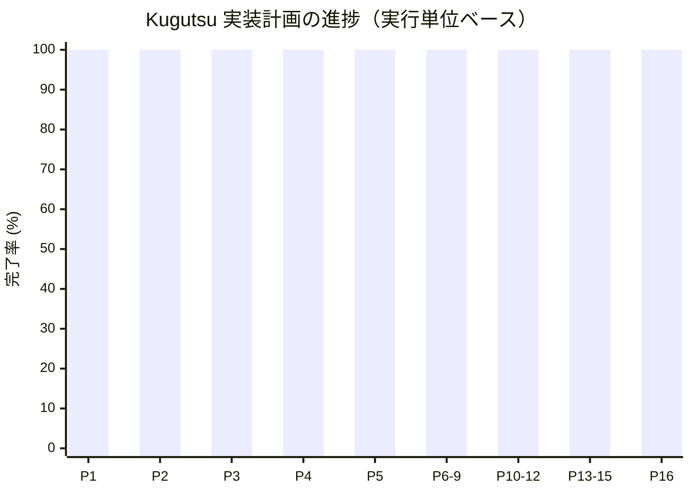

# Kugutsu 進捗

更新日: 2026-10-14

## 全体

- 実装計画: [TODO.md](TODO.md) にある156項目のうち156項目完了、未完了項目なし。
- 完成度: **100.00%**（156 ÷ 156。実装計画の各実行単位を等しい重みとして算定）。
- 現在フェーズ: **Phase 16 配布・セットアップ — 11/11項目、100.00%**。
- 完了範囲: Phase 1～5（実行基盤、MCP接続、操作バッファ、排他ロック、常駐UI）とP06-01～P06-09（ウィンドウ参照レジストリ、一覧、現在情報、座標変換、通常サイズへの復元、前面化・フォーカス確認、最小化、最大化、通常終了）、P07-01～P07-08（単一クリック・ダブルクリック・縦横ホイール・キー送信・Unicode入力・固定時間待機・ウィンドウ／全モニター画像取得）、P08-01～P08-06（UIドライバ契約・登録と能力照会・要素参照・UIA基盤・条件探索・構造取得）、P09-01～P09-14（UIA状態・値取得、Invoke、値・キー・選択・チェック・数値・展開・スクロール・複数選択・テキスト範囲・グリッド操作）。Phase 10は11/11項目、Phase 11はP11-01～P11-10の10/10項目を実装済みです。Phase 12は6/6項目、Phase 13は13/13項目を実装済みです。全7種類のシグナル監視とJSON signalKey参照を接続しました。Phase 14は18/18項目、Phase 15はP15-01～P15-08の8/8項目を実装済みです。画像操作はプロファイルと明示methodを必要とし、実機動作は未確認です。Phase 8は6/6項目、Phase 9は14/14項目、100%です。
- ビルド確認: 2026-10-14 `dotnet build Kugutsu.slnx --no-restore -p:UseSharedCompilation=false -m:1 -nr:false` 成功（警告0・エラー0）。自動テスト・実機操作は実行していません。
- 実機動作は未確認です。完了数はTODO.mdの実装項目を基準にし、実機検証済み項目数を表しません。

## フェーズ別進捗

| フェーズ | 完了 / 全項目 | 進捗 |
| --- | ---: | ---: |
| Phase 1 実行基盤 | 7 / 7 | 100% |
| Phase 2 MCP接続 | 9 / 9 | 100% |
| Phase 3 要求・操作バッファ | 13 / 13 | 100% |
| Phase 4 排他ロック | 6 / 6 | 100% |
| Phase 5 常駐UI | 7 / 7 | 100% |
| Phase 6～9 ウィンドウ操作・UIA | 37 / 37 | 100.00% |
| Phase 10～12 アプリ・シェル・ブラウザ・DOM | 27 / 27 | 100.00% |
| Phase 13～15 シグナル・画像認識・Aloe | 39 / 39 | 100.00% |
| Phase 16 配布・セットアップ | 11 / 11 | 100.00% |

## 次の作業

実装計画の全156項目が完了しました。実機インストール、更新、アンインストール、UI操作の検証は未実施です。

| 優先 | ID | 作業 | 依存・順序 |
| ---: | --- | --- | --- |

- P09-07 完了: 要求状態が一致する場合は再反転せず、三状態の循環を最大2回で辿って読戻しを確認します。

- P09-08 完了: RangeValueの値域・編集可否・SmallChange／LargeChangeを確認し、設定後の値を厳密に読み返します。

- P09-09 完了: 同じ展開状態なら操作を省略し、Expand／Collapse後の状態を確認します。

- P09-10 完了: Small／Large単位を1～20回適用し、取消と対象所属を各回で確認して最終位置を返します。

- P09-11 完了: 複数選択能力・全項目の所属・一意性を確認し、replace／add／remove後の集合を照合します。

- P09-12 完了: UTF-16の開始位置・長さをUIA境界へ照合し、選択後の両端点を確認します。

- P09-13 完了: 0起点の行列を検証し、仮想セルを実体化して所属・結合範囲を確認し、要素参照とメタデータを返します。

- P09-14 完了: セルの実体化・所属・編集可否を確認し、非機密値の読戻しと機密値の伏字を共通処理で適用します。Phase 9完了。

- P10-01 完了: 設定のコピーを固定し、実行ファイルの同一性・SHA-256・再解析ポイントと最終パスを利用時に照合する基盤をDIへ登録しました。起動APIはP10-02です。

- P10-02 完了: 登録対象を固定引数で起動し、同一SID・セッション・実行パスとPID・開始時刻を確認してapplicationIdを発行します。

- P10-03 完了: app.launchを再利用して同じPID・開始時刻の一意な表示ウィンドウを待ち、normal／maximizedを確認します。

- P10-04 完了: 管理アプリと主ウィンドウの世代を照合して通常終了を要求し、保持プロセスハンドルの終了を確認します。

- P10-05 完了: 専用sessionIdを管理アプリ・シェルプロセス・ウィンドウ・不透明入力先へ固定し、種類と世代を前後照合する基盤をDIへ登録しました。

- P10-06 完了: 新規識別タブを持つWindows Terminalを起動し、登録済みPowerShellの一意な子孫PIDとUIA入力ペインを照合して専用sessionIdを発行します。

- P10-07 完了: セッションと入力フォーカスを再照合し、文字列の各送出区間・各キー直前にタブとペインを確認して送信します。Enterは追加しません。

- P10-08 完了: 保持した識別タブ配下の閉じるボタンを一意に特定して通常終了を要求し、シェルPIDの終了確認後に専用sessionIdを破棄します。

- P10-09 完了: 許可登録した専用conhostとPowerShellを起動し、別プロセスでコンソール所属を確認してPowerShell種別のsessionIdを発行します。

- P10-10 完了: 管理PowerShellセッションへ文字列と明示キーを順番に送信し、種別・プロセス世代・コンソール所属・フォーカスを再照合。

- P10-11 完了: 専用Console Hostへ通常終了を要求し、管理PowerShellプロセスの終了確認後にセッションを削除。

- P11-01 完了: 現在ユーザーのHTTP/HTTPS関連付けを個別照会し、未設定・実行先不明・非対応を区別。

- P11-02 完了: ユーザー/マシンと32/64bitのブラウザ登録・既知App Paths・設定済み対象から実在するexeを検出。

- P11-03 完了: 種類・ブラウザ・ドライバーの管理プロセス世代とタブ参照を固定し、種類不一致・終了・接続断を区別する基盤を追加。

- P11-04 完了: Chrome 115以上と同一ビルドのChromeDriverを専用プロファイルで起動し、版・返却PID・親子関係・待受PIDを照合。

- P11-05 完了: browser.launchのedge実装を追加。専用ms:edgeOptions、先頭3部の版適合、返却プロファイルとOS上の一意なウィンドウ付き子孫を照合。

- P11-06 完了: browser.launchのfirefox実装を追加。Firefox 115以上とGeckoDriver 0.36.0、返却PID・専用プロファイル・版を照合。

- P11-07 完了: 管理タブとトップ文書を明示選択し、HTTP/HTTPS遷移のWebDriver完了応答と現在URLを返却。

- P11-08 完了: BiDiで履歴を1件戻り、履歴なしはmoved:false、対象完了通知と文書状態を確認。

- P11-09 完了: 共通履歴処理を使いBiDiで1件進む操作を接続。履歴範囲外はmoved:false。

- P11-10 完了: 管理セッションへ通常終了を要求し、ブラウザ終了確認後に専用ドライバーだけを停止して参照を削除。

- P12-01 完了: CSS・最大16階層のフレーム探索、状態メタデータ、文書ルートとネイティブ要素に結び付くDOM参照を追加。

- P12-02 完了: 文書ルート・保存フレーム・要素を再照合し、失効IDを保持。通常遷移・履歴移動・終了時に対象参照を無効化。

- P12-03 完了: 編集可否確認、ネイティブのクリアと入力、一致/長さ確認を追加。パスワード値は返さない。

- P12-04 完了: 可視・有効状態を確認してElement Clickを1回送信し、遮蔽はネイティブ判定で拒否。

- P12-05 完了: 共通キー列をWebDriver Actionsへ変換し、対象フォーカス再照合と押下状態の解放を追加。

- P12-06 完了: input/textarea/contenteditableの値取得を追加。パスワード値・長さを伏せ、応答量を制限。

- P13-01 完了: 所有セッション・ロック取得世代・期限・状態・一回限りの成立結果を保持する登録基盤を追加。

- P13-02 完了: MCPと共通操作へ監視登録を接続。所有者・ロック世代を引き継ぎ、監視開始・初期評価を確認。

- P13-03 完了: 単体MCPと共通操作へFIFO待機を接続し、成立・通常timeout・要求中断を区別。

- P13-04 完了: 所有者の監視解除をMCPと共通操作へ接続し、未成立待機へ解除理由を通知。

- P13-05 完了: HTTP要求がなくても200ms周期で期限・ロック世代を整理し、成立済み監視を停止。開始中の解除も資源生成完了を待って解放。

- P13-06 完了: 固定したウィンドウ世代の存在・アクティブ・最小化・最大化を設定間隔で観測し、消失待ちは成立を先に評価。

- P13-07 完了: WinEventの作成・表示通知を専用メッセージループで受信し、登録前のウィンドウを除いて条件に一致した参照を返す。

- P13-08 完了: UIAの有効・表示・フォーカス・トグル・選択状態をMTAで観測し、固定した要素参照の失効を検出。

- P13-09 完了: UIA Value/Textパターンの一致・包含を監視し、パスワード・不明な機密属性・長すぎる値を拒否。本文を観測結果へ保存しない。

- P13-10 完了: 登録時の文書・フレームを固定し、その中でCSSを都度検索。背景監視と通常操作のWebDriver選択状態を操作全体で排他。

- P13-11 完了: 固定した文書内で一意なCSS要素の表示テキストを比較し、入力値を読まず、本文を観測結果へ保存しない。

- P13-12 完了: 登録済みタブの現在URLを設定間隔で比較し、遷移を行わず、観測結果には一致結果と文字数だけを保存。

- P13-13 完了: 同一要求内の名前を登録結果のsignalIdへ結び付け、重複・未定義・前方参照・二重指定を受付前に拒否。単体シグナル操作にも所有者とロック世代を引き継ぐ。

- P14-01 完了: Tesseract 5.2.0 x86と固定SHA-256の日本語・英語モデルを接続し、メモリ内PNGから単語・矩形・OCR信頼度を返す基盤を実装。

- P14-02 完了: メモリ内PNGから矩形・入力欄候補を抽出し、形状根拠とrule_score、上限打切りを返す基盤を実装。

- P14-03 完了: ボタン候補の矩形規則を接続し、形状根拠とrule_scoreを保持。入力欄と重なる分類候補を暗黙に一意化しない。

- P14-04 完了: OCRの行・単語候補を入力欄の左・上、ボタン内部へ対応づけ、複数対応と信頼度の種類を保持。

- P14-05 完了: 対象アプリ・画面・ラベル・意味規則を厳密なJSONとして読込み、不正定義を拒否して版と内容SHA-256を保持。

- P14-06 完了: プロセス・タイトル・周辺OCRのリテラル条件を照合し、一致した画面と根拠を複数保持。

- P14-07 完了: 形状・ラベル・一致画面の明示規則から用途を別属性へ付け、複数解釈と未確定属性を保持。

- P14-08 完了: Test Engineを使わない画像・OCR・明示規則のドライバを登録し、期限と128MiB上限のフレーム表から共通候補を生成。

- P14-09 完了: 一般的な独自描画UI向けドライバを登録し、画像基盤を共有してドライバ別のプロファイル・参照を維持。

- P14-10 完了: ui.snapshotへ画像ドライバと任意profileIdを接続し、候補上限・includeImage・不明状態を適用。

- P14-11 完了: 画像ドライバの名前・種類・profileId・semanticRole検索を公開し、automationIdを受付前に拒否して候補一覧を返す。

- P14-12 完了: 期限・世代・DPI・矩形・プロファイルSHA-256・局所BGRA画素と5点ヒット先を照合し、変更時に再対応しない。

- P14-13 完了: プロファイルのborder_colorを対象の四辺で照合し、50ms隔てた2回の画像でフォーカス表示を確認。未定義・不足・参照失効時はUI_TARGET_UNVERIFIED等で拒否し、確認処理自体はクリックやキーを送らない。

- P14-14 完了: 画像ボタンの明示coordinate_clickを共通control.invokeへ接続。プロファイル付きボタンだけ許可し、移動前とクリック直前に局所画素と参照を照合、変更なら送信を拒否。

- P14-15 完了: 画像入力欄はcoordinate_keyboardとallowTextInput/focusIndicatorを必須にし、単一クリック後の各キーとUnicode送信前にフォーカス表示・参照・利用者押下を照合する。Ctrl+AとDeleteで置換し改行等制御文字を拒否。

- P14-16 完了: 画像入力欄へ明示coordinate_keyboardでキー列を送る経路を接続。許可付きプロファイルと各キー直前のフォーカス表示・参照照合を必須にし、入力後は画像参照を失効。

- P14-17 完了: 明示local_ocrとsensitive:falseの入力欄だけ、枠を除く内部画像からOCR値と単語・信頼度を返す。読取り前後の画素一致を確認し、空欄・打切り・複数行は確認不能として拒否。

- P14-18 完了: CrayworkソースのOpen Project/Path/Cancelを根拠に右側ラベルの識別規則をKugutsu内へ配置。フォーカス表示未確認のため入力許可はfalse、ビルドは既存設定を上書きしない。

- P15-01 完了: Aloeの3アセンブリ1.0.0.0とSHA-256を固定し、MITライセンスと同梱。読取りロック・リパース拒否・サイズ・名前・版・ハッシュ照合の依存リースをDIへ登録。Aloeバッチはまだ無効。

- 2026-10-14 今回はP14-02～P15-01の18項目を完了。5時間枠残量14%（取得時点）で新規ステップを停止。次回はP15-02 コンパイルアダプター。commit/push・自動テスト・実機操作は未実施。

- P15-02 完了: 固定AloeCompilerを内部AloeHost補助プロセスで使用し、Moduleは子のメモリへ保持。親はソース上限、私有フレーム、期限、取消時の終了確認、字句・構文エラーの固定コードを扱う。

- P15-03 完了: コンパイル済みModuleを同じ内部補助プロセスの固定AloeVmで一度だけ実行。一般用途入出力・Timer能力・Aloeログを無効化し、取消・要求期限・失敗時の終了確認を必須にする。

- P15-04 完了: Aloeのexecute_operation(name,argsJSON)を親の操作ディスパッチへ接続。子へ所有者やロックトークンを渡さず、既存引数スキーマ・所有文脈・操作期限を適用する。

- P15-05 完了: 命令予算・ホスト呼出し数・要求期限・私有フレーム上限とWindows Jobのメモリ上限を接続。超過位置を返し、観測を無効化するGCSetDebug/並行tickを拒否する。

- P15-06 完了: Aloeのコンパイル・実行・停止確認を1件のFIFO要求へ結び付け、要求期限を全体に適用。操作ごとの期限と所有者ロックの前後照合を維持し、停止未確認のまま次要求へ進めない。

- P15-07 完了: submit_batchのformat:aloeとsourceを有効化。JSONとの同時指定、ソースの範囲・Unicode、固定依存、要求ID・所有者・ロックを検証し、隔離実行全体を1件のFIFOへ登録。

- 2026-10-14 今回はP15-02～P15-07の6項目を完了。最後の利用枠照会で5時間枠残量2%を確認し、新規ステップを停止。次はP15-08。残量取得に応答遅延があり、ステップ開始時の取得値は19%でした。commit/push・自動テスト・実機操作は未実施。

- P15-08 完了: AloeへシグナルIDを返し、待機結果をsignaled／timeout文字列として条件分岐と解除に使えるホスト関数を接続

- P16-01 完了: 固定構成のアプリ・プロキシ・ConsoleProbe・AloeHost・Aloe依存物を版とSHA-256で照合してinstallation.jsonを生成

- P16-02 完了: WiX 7のx86 MSIでbin/config/dat/logsを標準配置へ収録しINSTALLFOLDER変更を可能にした

- P16-03 完了: MSIから対話的インストールユーザーのCredential Managerへ暗号学的乱数Bearer tokenを欠落時だけ作成し有効値を保持

- P16-04 完了: MSIのHKCU RunへKugutsu.exeを登録し導入ユーザーの対話ログオン時にトレイ常駐を起動

- P16-05 完了: MSIセットアップが実在するTerminal／PowerShell／conhost／Firefox／Chrome／Edgeだけを検出設定へ記録し、手動設定を優先

- P16-06 完了: 公式配布元からブラウザー版・OSアーキテクチャに合うWebDriverをセットアップ時に取得し署名を検証、版とSHA-256を記録

- P16-07 完了: 固定版Tesseractモデル2件・x86ネイティブライブラリ2件・モデルライセンスをSHA-256照合しinstallation.jsonへ記録、欠落時はMSIビルドを失敗

- P16-08 完了: 32ビットレジストリビューと実フォルダーを照合しx86 Microsoft.NETCore.App／WindowsDesktop.App／AspNetCore.Appの10.0.x不足を構造化判定

- P16-09 完了: 公式メタデータのSHA-512とMicrosoft署名を検証したx86 .NET 10 Desktop／ASP.NET Core RuntimeをセットアップEXEへ同梱し、不足分をMSI前に導入。MSI失敗時もセットアップを停止

- P16-10 完了: appsettings.jsonと資格情報を更新・削除後も保持し、製品ファイルとRun登録を削除。生成済みドライバー・検出情報を清掃し、共有ランタイムとログを維持。2026-10-14にBurnセットアップ1.0.1をE:\Kugutsuへ導入、終了コード0・アプリ起動・HKCU Run登録を確認。更新・削除は未検証。

- P16-11 完了: docs/USAGE.mdを追加しREADMEから参照。実機ではインストールとアプリ起動を確認。実際のMCP／ウィンドウ／ブラウザー操作は未検証。

- 2026-10-14 P16-06 clarification: ChromeDriverは公式未署名配布のため、公式HTTPS・Chromeビルドメタデータ・実行ファイルFileVersion完全一致時のみ許容。EdgeとFirefoxは発行者署名を維持。ADR 0011に出所検証の限界を記録。実機配置された3ドライバー全てのSHA-256がマニフェストと一致。

- 2026-10-14 release 1.0.1.0: Release、x86 MSI、Burnセットアップは各警告0・エラー0で成功。BurnセットアップがE:\Kugutsuへ終了コード0で導入。アプリ版1.0.1.0、MSI製品版1.0.1、Akatsukisoftメタデータ、プロセス起動、HKCU Run登録、ドライバー配置とSHA-256一致を確認。MSI/EXEは未署名。更新・アンインストールと実際のMCP／UI操作は未検証。テスト・commit・pushは未実施。
